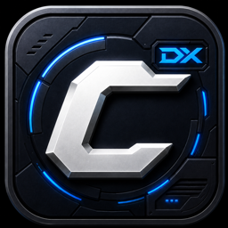
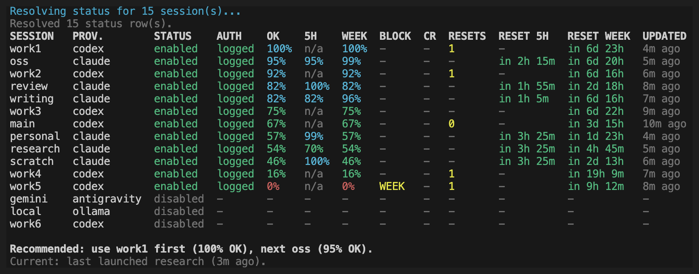
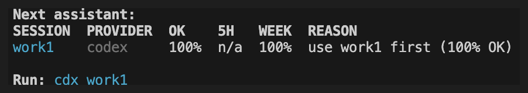

# CDX Manager

<br clear="left"/>

[](LICENSE)  

**The right AI coding account, when you need it.** CDX Manager keeps your Codex and Claude accounts in separate profiles, shows which ones have quota, and helps you pick the next usable session from your terminal.

When one account hits a limit mid-task, you should not have to guess which login still works or rebuild your context from memory. CDX shows the available accounts and can prepare a transcript-backed handoff to another session.



## Get started in a minute

Install with npm (Node.js 18+ and Python 3.9+):

```bash
npm install -g cdx-manager
cdx add codex work
cdx add claude personal
cdx status
cdx next
cdx work
```

`cdx next` recommends a session and prints the launch command; `cdx work` opens your isolated `work` profile. CDX also supports Antigravity and local Ollama sessions. Prefer pipx or uv? See [installation and setup](docs/getting-started.md).



## What you can do

| Need | CDX command | Detail |
| --- | --- | --- |
| See quota and choose an account | `cdx status`, `cdx next` | [Quota-aware routing](docs/features.md#quota-aware-routing) |
| Keep logins and settings separate | `cdx add`, `cdx <name>`, `cdx set` | [Isolated sessions](docs/features.md#isolated-multi-account-sessions) |
| Continue work in another session | `cdx handoff source target` | [Context handoff](docs/features.md#context-handoff) |
| Run a prompt from a script | `cdx run --prompt "..." --json` | [Headless automation](docs/features.md#headless-automation) |
| Inspect usage or get an alert | `cdx stats`, `cdx ready` | [Maintenance and notifications](docs/sessions-and-notifications.md) |
| See which agents wait for you | `cdx agents --json` | [Agent state](docs/sessions-and-notifications.md#agent-state) |

CDX checks authentication before interactive launches. Handoff keeps the source transcript in place and asks the receiving agent to verify the conversation and workspace before acting. No account switch or prompt submission happens just because you run `cdx next`.

## Cache efficiency and fix rounds

`cdx history --json` records uncached input, cache reads, cache writes, output tokens, and `usage.cache_hit_ratio` beside the existing token totals. The ratio is cache reads divided by all input tokens, excluding output. Missing provider splits stay `null`, and text views show `cache n/d` instead of claiming a zero hit rate.

`cdx stats --json` adds `cache_usage` sums and an input-weighted `cache_hit_ratio` to each session, project (`--by project`), model (`--by model`), and total. `cache_usage` preserves unknown sums as `null`; existing numeric aggregate fields keep their previous behavior. Ratios include only runs with measured input and cache reads. Coverage is explicit in `measured_runs` and `measured_input_tokens`. `run_types.cold` and `run_types.continued` expose counts, sums, and ratios for comparison. Text views show values such as `cache 72 %` next to tokens.

Reuse a completed run's provider conversation for another fix round:

```bash
cdx run work --cwd /path/to/repo --prompt "Implement the change" --reasoning-effort high --json
cdx run --continue-run RUN_ID --cwd /path/to/repo --prompt "Fix the remaining test failure" --json
```

`--continue-run` resumes the exact Claude session or Codex thread and pins the previous run's recorded model and effort, even if the profile settings changed. The profile is inferred from the parent; an explicit session or provider must match. An explicit model or effort must also match. Runs and history record `parent_run_id` and `conversation_id`. Detached continuations use the cdx child supervisor with the same pins. Codex continuation usage is measured between exact transcript snapshots before and after the run, since exec resume can report conversation totals. If either boundary is unavailable, per-run usage stays unknown with `usage_attribution: "continuation_usage_unavailable"` in history instead of counting earlier turns again.

Conservative assumption: a continuation requires a finished Claude or Codex run, a locally available provider transcript, and recorded model and effort settings. Missing runs, profiles, expired sessions, and unavailable settings produce a clear error; the caller can retry without `--continue-run` for a cold run. `--failover` and `--isolate-workspace` cannot be combined with continuation. Capacity recovery and provider model fallback are disabled for continuations so they cannot silently switch model or account. Provider cache retention remains provider-controlled, so resuming does not guarantee a cache hit.

## Run costs and budgets

`cdx history --json` includes nullable `cost_usd` for each entry, estimated from its observed usage and serving model using the same table and `CDX_TOKEN_PRICES` overrides as `cdx stats`. Unknown prices or usage stay `null`.

```bash
cdx run work --cwd /path/to/repo --prompt "Fix the tests" --budget 2.50 --json
```

`--budget` stops a run once its measured estimated cost reaches the USD amount, including with `--detach` and `--continue-run`. A budget stop exits with code 125 and reports `error.code: "budget_exceeded"` and `error.spent_usd`. Detached callers read the final result through `cdx run-status` or `cdx run-report`. Usage arrives in provider updates, so the estimate can overshoot; unknown usage or prices cannot trigger a budget stop. See the [budget contract](docs/cli.md#run-budgets) for details.

## Codex model capacity recovery

`cdx run` (including `--detach`) automatically recovers from Codex's "Selected model is at capacity" failure. It retries the same prompt, profile, and model after 1 and 2 seconds, then tries the profile's `fallback_model` list in configured order, removing duplicates. Configure alternatives with `cdx set work --fallback-model MODEL_A,MODEL_B`.

After exhausting those models, CDX selects another ready Codex profile using the normal ranking, including profile priority. Disabled, logged-out, `never`, and `ask-first` profiles are excluded from automatic selection. To choose an `ask-first` profile explicitly, name it in a new command (`cdx run NAME ...`). Each successor uses `--model` if supplied, otherwise its own configured/default model, followed by its own fallback list. Each model gets at most three attempts; at most four profile switches are allowed. Settings are not changed. Each attempt retains the command's timeout; the backoff adds at most three seconds per model.

Recovery does not require `--failover`, which still controls account quota exhaustion separately. Other provider failures and timeouts do not trigger capacity recovery. Attempts restart the prompt in the same workspace; files from earlier attempts remain there. Each retry, model fallback, profile fallback, and exhausted budget is logged to stderr and persisted in `recovery_events` in the run registry and final JSON (`cdx run-status` / `cdx run-report`). Events include archived attempt output paths. Recovery keeps one run ID and reports the final effective model. If no eligible alternative remains or the profile switch budget is reached, the run fails with `capacity_recovery_exhausted`.

## Documentation

- [Installation and first steps](docs/getting-started.md) — prerequisites, npm/pipx/uv, Windows, configuration.
- [Features and handoff](docs/features.md) — routing, isolated accounts, automation, recovery.
- [Sessions and notifications](docs/sessions-and-notifications.md) — alerts, launch settings, history.
- [Command and JSON reference](docs/cli.md) — commands, selection, usage fields, programmatic contracts.
- [Operations](docs/operations.md) — backup, disk cleanup, Windows notes, troubleshooting, release procedure.
- [Technical overview](docs/technical-overview.md) — isolation, status sources, project and data layout.
- [Tray companion testing](docs/tray-local-testing.md) — local development loops.

Contributions are welcome; see [CONTRIBUTING.md](CONTRIBUTING.md). CDX Manager is [MIT licensed](LICENSE).

### Run Codex on an SSH worker

```sh
cdx run work --remote agent@worker --cwd /srv/project --prompt 'Run the checks' --json
cdx run work --remote worker --cwd /srv/project --prompt-file task.txt --detach --label checks --budget 2 --json
cdx run work --remote Spire --remote-prefix 'wsl.exe -d Ubuntu --' --cwd /srv/project --prompt 'Run the checks' --json
```

The controller remains the authority for the profile, quota, history, costs and
run registry. Use `run-status`, `run-report` and `run-tail` on the controller with
the returned run ID. Permission, model, reasoning effort, prompt, timeout, budget,
label and detached execution use the existing run options. `--cwd` names an
absolute directory on the worker; it need not exist on the controller. Files are
not synchronized. Use `--project` to explicitly attribute a remote checkout to a
project. Remote runs do not retry or fail over automatically, including when
`--failover` is supplied.

Requirements: a POSIX controller with `ssh` and Codex on PATH, and a Linux worker
with Python 3, memory-backed `/dev/shm`, and exactly the same `codex --version`.
Configure SSH keys, host trust and aliases in advance; the connection uses batch
mode and bounded connection/keepalive timeouts. Provider refusal, unreachable
workers and version mismatches fail before sending credentials. Only Codex OAuth
profiles are supported. Remote continuation is refused because the temporary home
does not preserve conversation rollouts. Codex's native permission sandbox still
applies to ordinary remote runs.

For SSH servers landing in Windows `cmd.exe` (including Spire and Citadel), pass
`--remote-prefix 'wsl.exe -d Ubuntu --'` to enter Linux before starting Python.
The prefix accepts plain command words, options and paths without spaces or shell
metacharacters; it is forwarded to detached runs. POSIX targets need no prefix.
Only a short, double-quoted Python bootstrap is sent in the SSH command line;
the worker and shared sandbox source are framed on stdin before the payload.
Neither source size nor prompt size consumes cmd.exe's 8191-character command limit.

`--isolate-workspace` now checks the worker's **same local isolation mechanism**:
bubblewrap, pasta (passt), nftables, Python, the checkout/toolchain allowlist,
and an actual namespace/network setup using a dummy credential. Missing dependencies,
namespace denial or invalid checkouts fail before sending real credentials, without
an unisolated fallback. However, even a successful probe currently returns
`remote_isolation_unavailable`: the local mechanism mounts
`/home/agent/.codex/auth.json` read-only for Codex, and agent tool subprocesses can
read it too. That file contains the temporary bearer (potentially valid for ten
days); a read-only mount does not protect its confidentiality. Remote isolated
runs therefore **remain unavailable and are refused**, including direct worker
invocation. A provider channel that keeps the bearer outside the tools' sandbox
is required before enabling them. The ordinary remote path remains an explicit
choice with its existing credential exposure; this change does not claim that
local workspace isolation hides provider authentication from tools.

The controller takes the profile's authentication lock and refreshes through its
local [Codex app-server](https://learn.chatgpt.com/docs/app-server) when `last_refresh` is older than seven days or the access
token has less than 24 hours left. It verifies freshness after refreshing and
fails closed if freshness or expiration cannot be established. Only
`access_token`, `id_token`, `account_id` and `last_refresh` travel, with an empty
`refresh_token`. The rotating refresh token never leaves the controller. The
credential travels exclusively over SSH stdin, and is absent from command
arguments, environment variables, run records and output. The agent receives
`/dev/null` as stdin, not the bootstrap script or credential transport.

Each worker run gets a private mode-700 home under
`/dev/shm/cdx-remote-<uid>/run-*`, with mode-600 `auth.json` and file-only credential storage. Only non-secret scalar
preferences (`model`, `model_reasoning_effort`, `service_tier`, `personality`,
`model_context_window`, `model_auto_compact_token_limit`) from the top level of
`config.toml` are copied. Hooks, custom providers, environment settings and other
controller-local configuration are not copied. The home is removed on completion,
failure, cancellation and SSH stdin closure. Stop a detached run by sending
SIGTERM to the controller PID returned at launch. Uncatchable worker termination
can leave a home behind; the next launch sweeps homes whose worker lock is no
longer held. No persistent worker authentication is installed or refreshed.

A profile occupied by a remote run is busy for local and remote runs using the
same controller through the run registry. The authentication lock is held only
while refreshing and validating the credential snapshot, then released before SSH
launch. Scheduled `cdx auth refresh` and quota probes can acquire it during a long
mission; they no longer see a mission-long `locked`/`auth_refresh_indeterminate`
result. A probe overlapping the short snapshot can still report contention.
Controller renewal does not extend the worker's copied access token; quota remains
one controller-side account snapshot, never a worker copy. Multiple independent controllers sharing copied OAuth profiles are not
supported. Costs and budget checks use measured worker usage and observed rollout
models; unknown prices and delayed provider reporting retain the usual budget
limitations. A run that outlives the access credential fails with
`remote_credential_expired`, requiring a new controller launch.

The empty-refresh-token behavior was measured with Codex CLI 0.166.0. Real-host
acceptance should verify that the installed matching CLI does not attempt a
refresh with the temporary home, that the controller token chain stays unchanged
for a fresh credential, and that cleanup works after disconnect and SIGTERM.
