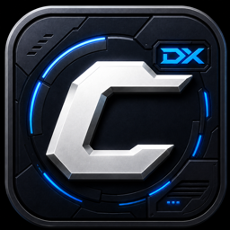
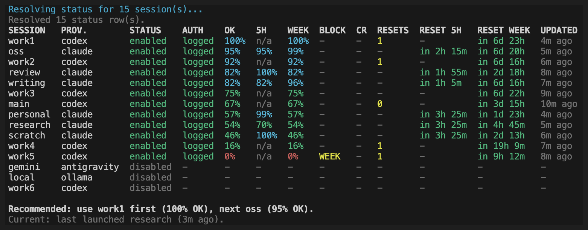
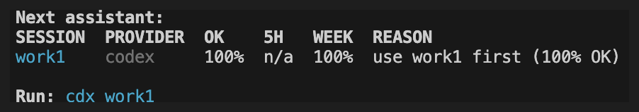

# CDX Manager

<br clear="left"/>

[](LICENSE)  

**The right AI coding account, when you need it.** CDX Manager keeps your Codex and Claude accounts in separate profiles, shows which ones have quota, and helps you pick the next usable session from your terminal.

When one account hits a limit mid-task, you should not have to guess which login still works or rebuild your context from memory. CDX shows the available accounts and can prepare a transcript-backed handoff to another session.



## Get started in a minute

Install with npm (Node.js 18+ and Python 3.9+):

```bash
npm install -g cdx-manager
cdx add codex work
cdx add claude personal
cdx status
cdx next
cdx work
```

`cdx next` recommends a session and prints the launch command; `cdx work` opens your isolated `work` profile. CDX also supports Antigravity and local Ollama sessions. Prefer pipx or uv? See [installation and setup](docs/getting-started.md).



## What you can do

| Need | CDX command | Detail |
| --- | --- | --- |
| See quota and choose an account | `cdx status`, `cdx next` | [Quota-aware routing](docs/features.md#quota-aware-routing) |
| Keep logins and settings separate | `cdx add`, `cdx <name>`, `cdx set` | [Isolated sessions](docs/features.md#isolated-multi-account-sessions) |
| Continue work in another session | `cdx handoff source target` | [Context handoff](docs/features.md#context-handoff) |
| Run a prompt from a script | `cdx run --prompt "..." --json` | [Headless automation](docs/features.md#headless-automation) |
| Inspect usage or get an alert | `cdx stats`, `cdx ready` | [Maintenance and notifications](docs/sessions-and-notifications.md) |
| See which agents wait for you | `cdx agents --json` | [Agent state](docs/sessions-and-notifications.md#agent-state) |

CDX checks authentication before interactive launches. Handoff keeps the source transcript in place and asks the receiving agent to verify the conversation and workspace before acting. No account switch or prompt submission happens just because you run `cdx next`.

## Quota provenance in status JSON

Every profile in `cdx status --json` (including `--cached` and a named profile)
includes `quota_windows.5h` and `quota_windows.weekly` alongside the existing
percentage, reset and timestamp fields. Each window contains:

- `source`: `codex_rate_limits` for the existing `account/rateLimits/read`
  reader, `claude_probe` for the existing one-token Claude probe,
  `claude_statusline` for explicitly identified Claude statusline evidence,
  `cache` for legacy/local evidence without a known provider origin, or
  `unknown` when the window has no measurement. A cached reading retains its
  known original source; no extra probe is performed for this metadata.
- `observed_at`: the ISO 8601 measurement time for this profile and window,
  or `null` when absent or unknown. Reading a cache never advances this time.
- `availability`: `measured` below the freshness threshold, `stale` at or
  beyond it (or when a value has no valid observation time), or `unavailable`
  when no value exists or the current read/authentication attempt failed.
- `reason`: `null` unless unavailable; otherwise a stable explanation such
  as `missing_window`, `login_required`, `login_expired`, `quota_read_failed`,
  `probe_timeout`, `auth_probe_failed`, `profile_disabled`, or the Codex
  diagnostic reason (`auth_locked`, `initialize_failed`,
  `rate_limits_read_failed`, `missing_rate_limits`, `codex_cli_not_found`,
  `missing_auth_home`, `probe_failed`). Provider error bodies are not copied.

Freshness thresholds match the existing cache TTLs: Codex **300 seconds**,
Claude **600 seconds**, and other providers **60 seconds** for these generic
window fields. Provider-specific fields such as Antigravity's quota freshness
retain their existing semantics. Missing windows remain `null`, never an
assumed 0% or 100%. On a failed refresh, existing cached percentages and reset
times remain available for compatibility, but the new availability is
`unavailable` with the failure reason and the original observation time.
Transient read errors describe the current command; `--cached` evaluates the
stored evidence and authentication state without making a new read attempt.
Reset times describe the quota window, not when it was measured.

## Automatic mission concurrency per profile

```bash
cdx set work --max-parallel 2
cdx show work
cdx unset work --max-parallel
```

`--max-parallel` accepts an integer from 0 to 5 and stores `launch.max_parallel`
next to `priority` and `policy`. Zero excludes the profile from automatic
missions. An absent value adds no profile-specific ceiling: the scheduling
client applies its own rule. Existing configurations need no migration.
`cdx unset work --all` also removes the limit.

The scheduling client is responsible for enforcing this metadata. It is
separate from the existing per-command `cdx run --max-parallel` limit.
`cdx --json` (also `cdx ls --json`) includes the optional field in each
session's `launch` object; `cdx status --json` exposes `max_parallel` on each
row (`null` when absent). `cdx show` is an alias for `cdx config` and displays
`Max parallel` as `default` when unset.

## Cache efficiency and fix rounds


`cdx history --interactive --cwd /path/to/project --limit 50 --json` finds interactive launches without mission runs consuming the result window. `--cwd` compares resolved paths (including symlinks and `~`), exactly, without including child directories. Both filters apply before `--limit` and also work with profile names, period filters and `--summary`. `--interactive` excludes headless `run` entries, detached entries and labels starting with `mission:`; unlabelled legacy launches remain eligible.

Interactive launches appear as `status: "running"` as soon as the provider starts, including `cdx start <name> --dir PATH` (an alias for `cdx <name> --dir PATH`) inside tmux. Completion or failure updates the same run ID. Active runtimes from older supervisors are included while their process remains alive; vanished unrecorded launches cannot be reconstructed.

History entries expose `conversation_id` and `provider_transcript_match: "conversation_id"` when an exact provider transcript exists. Claude uses its launch session ID; Codex can recover a unique thread from transcript metadata matching the launch directory and time window. Ambiguous discovery remains `provider_transcript_match: "recency"`, an explicitly unverified fallback that must not be treated as a verified resume target. A known ID with no transcript does not borrow another conversation. Existing history is enriched on read without rewriting old rows.

`first_user_prompt` contains the first real user text (up to 2,000 characters) from a bounded, redacted transcript read. Provider command wrappers, system reminders, tool results and bare absolute file paths are skipped. Missing, oversized or unavailable evidence leaves the prompt unknown; a supplied initial prompt is used when available.

`cdx history --json` records uncached input, cache reads, cache writes, output tokens, and `usage.cache_hit_ratio` beside the existing token totals. The ratio is cache reads divided by all input tokens, excluding output. Missing provider splits stay `null`, and text views show `cache n/d` instead of claiming a zero hit rate.

`cdx stats --json` adds `cache_usage` sums and an input-weighted `cache_hit_ratio` to each session, project (`--by project`), model (`--by model`), and total. `cache_usage` preserves unknown sums as `null`; existing numeric aggregate fields keep their previous behavior. Ratios include only runs with measured input and cache reads. Coverage is explicit in `measured_runs` and `measured_input_tokens`. `run_types.cold` and `run_types.continued` expose counts, sums, and ratios for comparison. Text views show values such as `cache 72 %` next to tokens.

Reuse a completed run's provider conversation for another fix round:

```bash
cdx run work --cwd /path/to/repo --prompt "Implement the change" --reasoning-effort high --json
cdx run --continue-run RUN_ID --cwd /path/to/repo --prompt "Fix the remaining test failure" --json
```

`--continue-run` resumes the exact Claude session or Codex thread and pins the previous run's recorded model and effort, even if the profile settings changed. The profile is inferred from the parent; an explicit session or provider must match. An explicit model or effort must also match. Runs and history record `parent_run_id` and `conversation_id`. Detached continuations use the cdx child supervisor with the same pins. Codex continuation usage is measured between exact transcript snapshots before and after the run, since exec resume can report conversation totals. If either boundary is unavailable, per-run usage stays unknown with `usage_attribution: "continuation_usage_unavailable"` in history instead of counting earlier turns again.

Headless runs, including detached, remote and continued runs, keep their
conversation identity in run records and history without replacing the profile's
interactive conversation.

Conservative assumption: a continuation requires a finished Claude or Codex run, a locally available provider transcript, and recorded model and effort settings. Missing runs, profiles, expired sessions, and unavailable settings produce a clear error; the caller can retry without `--continue-run` for a cold run. `--failover` and `--isolate-workspace` cannot be combined with continuation. Capacity recovery and provider model fallback are disabled for continuations so they cannot silently switch model or account. Provider cache retention remains provider-controlled, so resuming does not guarantee a cache hit.

## Run costs and budgets

`cdx history --json` includes nullable `cost_usd` for each entry, estimated from its observed usage and serving model using the same table and `CDX_TOKEN_PRICES` overrides as `cdx stats`. Unknown prices or usage stay `null`.

```bash
cdx run work --cwd /path/to/repo --prompt "Fix the tests" --budget 2.50 --json
```

`--budget` stops a run once its measured estimated cost reaches the USD amount, including with `--detach` and `--continue-run`. A budget stop exits with code 125 and reports `error.code: "budget_exceeded"` and `error.spent_usd`. Detached callers read the final result through `cdx run-status` or `cdx run-report`. Usage arrives in provider updates, so the estimate can overshoot; unknown usage or prices cannot trigger a budget stop. See the [budget contract](docs/cli.md#run-budgets) for details.

## Codex model capacity recovery

`cdx run` (including `--detach`) automatically recovers from Codex's "Selected model is at capacity" failure. It retries the same prompt, profile, and model after 1 and 2 seconds, then tries the profile's `fallback_model` list in configured order, removing duplicates. Configure alternatives with `cdx set work --fallback-model MODEL_A,MODEL_B`.

After exhausting those models, CDX selects another ready Codex profile using the normal ranking, including profile priority. Disabled, logged-out, `never`, and `ask-first` profiles are excluded from automatic selection. To choose an `ask-first` profile explicitly, name it in a new command (`cdx run NAME ...`). Each successor uses `--model` if supplied, otherwise its own configured/default model, followed by its own fallback list. Each model gets at most three attempts; at most four profile switches are allowed. Settings are not changed. Each attempt retains the command's timeout; the backoff adds at most three seconds per model.

Recovery does not require `--failover`, which still controls account quota exhaustion separately. Other provider failures and timeouts do not trigger capacity recovery. Attempts restart the prompt in the same workspace; files from earlier attempts remain there. Each retry, model fallback, profile fallback, and exhausted budget is logged to stderr and persisted in `recovery_events` in the run registry and final JSON (`cdx run-status` / `cdx run-report`). Events include archived attempt output paths. Recovery keeps one run ID and reports the final effective model. If no eligible alternative remains or the profile switch budget is reached, the run fails with `capacity_recovery_exhausted`.

## Documentation

- [Installation and first steps](docs/getting-started.md) — prerequisites, npm/pipx/uv, Windows, configuration.
- [Features and handoff](docs/features.md) — routing, isolated accounts, automation, recovery.
- [Sessions and notifications](docs/sessions-and-notifications.md) — alerts, launch settings, history.
- [Command and JSON reference](docs/cli.md) — commands, selection, usage fields, programmatic contracts.
- [Operations](docs/operations.md) — backup, disk cleanup, Windows notes, troubleshooting, release procedure.
- [Technical overview](docs/technical-overview.md) — isolation, status sources, project and data layout.
- [Tray companion testing](docs/tray-local-testing.md) — local development loops.

Contributions are welcome; see [CONTRIBUTING.md](CONTRIBUTING.md). CDX Manager is [MIT licensed](LICENSE).

### Run Codex or Ollama on an SSH worker

```sh
cdx run work --remote agent@worker --cwd /srv/project --prompt 'Run the checks' --json
cdx run work --remote worker --cwd /srv/project --prompt-file task.txt --detach --label checks --budget 2 --json
cdx run work --remote Spire --remote-prefix 'wsl.exe -d Ubuntu --' --cwd /srv/project --prompt 'Run the checks' --json
```

The controller remains the authority for the profile, quota, history, costs and
run registry. Use `run-status`, `run-report` and `run-tail` on the controller with
the returned run ID. Permission, model, reasoning effort, prompt, timeout, budget,
label and detached execution use the existing run options. `--cwd` names an
absolute directory on the worker; it need not exist on the controller. Files are
not synchronized. Use `--project` to explicitly attribute a remote checkout to a
project. Remote runs do not retry or fail over automatically, including when
`--failover` is supplied.

For Codex: a POSIX controller with `ssh` and Codex on PATH, and a Linux worker
with Python 3, memory-backed `/dev/shm`, and exactly the same `codex --version`.
Configure SSH keys, host trust and aliases in advance; the connection uses batch
mode and bounded connection/keepalive timeouts. Provider refusal, unreachable
workers and version mismatches fail before sending credentials. Codex requires an OAuth
profile. Remote continuation is refused because the temporary home
does not preserve conversation rollouts. Codex's native permission sandbox still
applies to ordinary remote runs.

For SSH servers landing in Windows `cmd.exe` (including Spire and Citadel), pass
`--remote-prefix 'wsl.exe -d Ubuntu --'` to enter Linux before starting Python.
The prefix accepts plain command words, options and paths without spaces or shell
metacharacters; it is forwarded to detached runs. POSIX targets need no prefix.
Only a short, double-quoted Python bootstrap is sent in the SSH command line;
the worker and shared sandbox source are framed on stdin before the payload.
Neither source size nor prompt size consumes cmd.exe's 8191-character command limit.

Remote Ollama profiles also support headless text generation:

```bash
cdx run local --remote worker --cwd /srv/project --model qwen3:8b --prompt-file question.txt --isolate-workspace --json
```

Here `local` is an existing Ollama profile. The named model must already be
installed on the worker's unauthenticated `127.0.0.1:11434` Ollama API; CDX
never downloads a missing model and rejects cloud-backed models. The prompt
file is read on the launching host and sent as content over SSH. This path
uses `/api/show` and `/api/chat` with `stream: false`, without an Ollama CLI or
Codex installation. Results identify `execution_mode: "text_generation"` and
include generated text in `result`, plus `prompt_eval_count` / `eval_count`
and normalized input/output token counts in `usage`.

Ollama is not an autonomous coding agent and does not edit the repository.
With `--isolate-workspace`, the checkout is read-only and the client has its
own network namespace without network access, including when `--network-access`
is supplied. A private Unix socket connects it to a supervisor-owned relay
with the fixed loopback destination and only the selected model's capability
and non-streaming inference calls allowed. Pull, delete, push, arbitrary URLs,
proxying and redirects are refused. No `~/.ollama` directory or model files
are mounted. The relay is removed on completion or cancellation. Remote
continuation remains unsupported; an explicit model or profile model is required.

Codex `--remote` supports `--isolate-workspace` using the same local isolation mechanism:
bubblewrap, pasta (passt), nftables, Python, the checkout/toolchain allowlist,
and an actual namespace/network setup using a dummy credential. Missing dependencies,
namespace denial or invalid checkouts fail before sending real credentials, without
an unisolated fallback.

For **every isolated Codex run**, local or remote, the sandbox mounts only a
run-private, mode-600 `auth.json` on verified memory-backed storage, with an empty
`refresh_token`. It never mounts the controller profile's full authentication file.
The controller refreshes under the authentication lock at the thresholds below
before preparing the snapshot, then releases the lock for the run. The temporary
home is removed after success, failure, launch errors and stop. Non-isolated local
runs and interactive login/refresh retain their normal profile authentication.

**Accepted residual risk (operator decision, 2026-11-01):** agent tools inside the
sandbox can read the copied access token, which can remain valid for up to ten
days. A read-only mount prevents modification, not disclosure. The rotating refresh
token never enters the sandbox or leaves the controller. Codex was measured to run
with an empty refresh token on 2026-11-01.

A long isolated Tower mission keeps its original credential snapshot even when
scheduled controller refresh updates the real profile. There is no authentication
writeback or token renewal inside the sandbox. A run that outlives its access token
fails with a clear temporary-credential expiry error and must start a new run.

The controller takes the profile's authentication lock and refreshes through its
local [Codex app-server](https://learn.chatgpt.com/docs/app-server) when `last_refresh` is older than seven days or the access
token has less than 24 hours left. It verifies freshness after refreshing and
fails closed if freshness or expiration cannot be established. Only
`access_token`, `id_token`, `account_id` and `last_refresh` travel, with an empty
`refresh_token`. The rotating refresh token never leaves the controller. The
credential travels exclusively over SSH stdin, and is absent from command
arguments, environment variables, run records and output. The agent receives
`/dev/null` as stdin, not the bootstrap script or credential transport.

Each worker run gets a private mode-700 home under
`/dev/shm/cdx-remote-<uid>/run-*`, with mode-600 `auth.json` and file-only credential storage. Only non-secret scalar
preferences (`model`, `model_reasoning_effort`, `service_tier`, `personality`,
`model_context_window`, `model_auto_compact_token_limit`) from the top level of
`config.toml` are copied. Hooks, custom providers, environment settings and other
controller-local configuration are not copied. The home is removed on completion,
failure, cancellation and SSH stdin closure. Stop a detached run by sending
SIGTERM to the controller PID returned at launch. Uncatchable worker termination
can leave a home behind; the next launch sweeps homes whose worker lock is no
longer held. No persistent worker authentication is installed or refreshed.

A profile occupied by a remote run is busy for local and remote runs using the
same controller through the run registry. The authentication lock is held only
while refreshing and validating the credential snapshot, then released before SSH
launch. Scheduled `cdx auth refresh` and quota probes can acquire it during a long
mission; they no longer see a mission-long `locked`/`auth_refresh_indeterminate`
result. A probe overlapping the short snapshot can still report contention.
Controller renewal does not extend the worker's copied access token; quota remains
one controller-side account snapshot, never a worker copy. Multiple independent controllers sharing copied OAuth profiles are not
supported. Costs and budget checks use measured worker usage and observed rollout
models, using the same exact-thread reader and 128 MiB rollout limit as local
isolated runs. Content-free evidence travels in supervisor frames separated from
provider stdout; raw rollouts and credentials are never returned. Live rollout
counters can stop an over-budget run before `turn.completed`. Unknown prices and
delayed provider reporting retain the usual budget limitations. With `--budget`,
measured but unpriceable usage still fails with `budget_unverifiable` (exit 125),
even after the provider finishes, preserving the documented fail-closed guarantee.
Provider output remains in the run artifacts; without a budget, a completed run
keeps its provider status and unknown cost. A run that outlives the access credential fails with
`remote_credential_expired`, requiring a new controller launch.

The empty-refresh-token behavior was measured with Codex CLI 0.166.0. Real-host
acceptance should verify that the installed matching CLI does not attempt a
refresh with the temporary home, that the controller token chain stays unchanged
for a fresh credential, and that cleanup works after disconnect and SIGTERM.

### Read an interactive conversation

`cdx conversation <name> [--conversation ID] [--cwd PATH] [--since ISO] [--cursor CURSOR | --tail N | --before CURSOR] [--limit N] --json`
returns a read-only JSON page for the profile's current conversation. An explicit
conversation ID uses an exact transcript lookup and never falls back. When the
profile's recorded ID has no transcript on this host (for example after a remote
run on another host), or there is no recorded ID, the command selects the latest
local transcript for `--cwd PATH`, defaulting to the process working directory.
Claude-compatible providers use `.claude/projects/<path-slug>`; Codex requires
a matching `cwd` in the rollout's initial `session_meta` record. Missing or
unreadable Codex metadata is excluded. `--since ISO` further restricts fallback
to transcripts modified at or after the session start timestamp (for example
`--since 2026-11-04T00:39:00Z`). Callers should pass a timestamp with a timezone.
Without a candidate, JSON reports `status: "unavailable"` and
`reason: "no_conversation_yet"`, including while a new session awaits folder trust.
This fallback is best effort and does not rewrite the recorded ID. Exact ID
lookups remain independent of these fallback constraints. JSON `resolution_method` is
`conversation_id` for an exact match, `recency` for a local fallback, or `null`
when no transcript is resolved. JSON `resolution_scope` records the canonical
absolute `cwd` and supplied `since` timestamp for fallback attempts, including
unavailable results; `since` is `null` when omitted. Exact lookups and unsupported
providers report a `null` scope. A missing explicit ID still reports
`transcript_not_found`.

The normal cdx JSON envelope includes `status`, `reason`, `provider`, `session`,
`entries`, `next_cursor`, and `has_more`. Each entry has exactly `role`
(`user`, `assistant`, or `tool`), `text`, `tool_name`, `tool_summary`, `at`, and
`id`. Missing values are `null`; normal tool text is empty. Entries follow file and
content-block order, with stable IDs for the same file position. Timestamps are
provider timestamps when valid. Tool calls/results have a name and a short
summary; arguments, results, attachments, and reasoning blocks are omitted.
Result names are recovered from recent calls, otherwise `tool`. The cache holds
up to 100 names and is trimmed oldest first to 2 KiB of compact JSON when saved
in a cursor. Existing version-1 cursors with larger caches remain readable.
Common credential patterns and secret assignments in text are redacted without
opening credential stores. Review conversation text before sharing: arbitrary
unlabelled sensitive prose cannot be identified automatically.

Pass `next_cursor` unchanged as `--cursor` to fetch the next page or poll for new
entries. `--limit` bounds entries (default 100, range 1–1000). Reading seeks to
the saved byte position rather than replaying history, and stops scanning after
8 MiB per call, finishing the current record when it crosses that budget.
A page may be empty while still returning a usable cursor. Poll on a
timer: `has_more` means unread bytes, which can include an incomplete final line
that will only become readable after the provider appends its newline.

Start near the present with `cdx conversation work --tail 100 --json`.
`--tail N` returns the last N normalized entries (1–1000) in chronological order.
It reads backwards in 64 KiB blocks, retaining at most a 1 MiB record prefix;
it does not replay the transcript from the beginning. Records that produce
multiple entries can split across pages. The same redaction, tool summaries,
oversized-record placeholders and file-position IDs apply. Recent tool names are
recovered from a 64 KiB lookback (extended to 8 MiB when resolving a result in the selected window), with the usual `tool`
fallback. Finding N entries can require scanning more bytes when records
are oversized or contain no visible entries. Incomplete trailing records are
excluded until their newline arrives.

Tail and backward pages add `before_cursor`: pass it unchanged as
`--before CURSOR --limit N` to load the preceding entries, also in chronological
order. `before_cursor: null` means the beginning has been reached. You can also
use `--before CURSOR --tail N`; `--tail` sets the count when both count options
are present. `next_cursor` still works with `--cursor` to follow entries after
the returned page, including messages appended after an initial tail read.
`has_more` continues to describe unread bytes **after** that page; use
`before_cursor` to decide whether older pages remain. `--cursor` cannot be
combined with `--tail` or `--before`. Without either new option, the existing
forward page contract is unchanged.

Backward cursors retain the original file size, modification time and boundary
anchors. Replacement, truncation or a detected in-place rewrite returns
`reset_required`; appending new messages preserves backward pagination. As with
forward cursors, transcripts must be append-only: bounded boundary checks cannot
detect every arbitrary edit elsewhere in a file that also grows.

Codex response items and Claude-compatible JSONL transcripts (Claude and
Antigravity) are supported through the existing transcript resolver. Only
`response_item` records from Codex and `user`/`assistant` records with `message`
from Claude-compatible transcripts are read, including their tool blocks. All
other record types are ignored, even when they repeat conversation content. Missing or
unreadable files return `status: "unavailable"` with a reason. Ollama's terminal
capture does not reliably identify message roles and returns
`status: "unsupported"`, including when no capture exists. A transcript record
larger than 1 MiB is skipped with bounded reads through its newline. For an allowed conversation record with readable type and message metadata, it produces
one entry containing `[élément trop volumineux ignoré]`, with a stable ID and a
role recovered from structural metadata in the readable prefix, or `tool` when
unknown. Records whose type or message cannot be established from the bounded
prefix are ignored. Its body, images and attachments are never returned. The cursor advances
past that record so later messages remain accessible. An oversized final record
without a newline produces no entry yet and is retried on the next call.
A replaced/truncated file or invalid
cursor returns `reset_required`; discard the cursor and reload the conversation.
Cursors are opaque, versioned, and bound to a provider and file. Treat transcripts
as append-only; reset the client if a provider rewrites earlier history.

Python callers can use the same page contract:

```python
from cdx_manager.conversation import read_conversation

page = read_conversation("claude", "/path/to/profile/home", conversation_id="session-id", limit=100)
next_page = read_conversation(
    "claude", "/path/to/profile/home", conversation_id="session-id",
    cursor=page["next_cursor"], limit=100,
)
```

### Claude quota status line

cdx installs a cache-only `statusLine` command in each new Claude profile's
`.claude/settings.json` and updates it on copy, rename, import, interactive launch/resume or `cdx set` /
`cdx unset`. Existing profiles pick it up at their next interactive launch.
The line uses the launcher's eight-cell remaining-capacity gauge, for example:

```text
█▁▁▁▁▁▁▁  5h 25% · wk 16% (reset Nov 07 09:30) · grif
```

The gauge follows the lowest known window. Each window below 20% includes its
cached reset time when available. `stale` marks observations at least ten minutes
old, missing an observation timestamp, or dated in the future. Missing, unreadable,
malformed, or unknown quota data produces only `quota ?`, with no error output.
The status command reads `sessions.json` directly without taking a store lock,
refreshing authentication, starting a provider, or making a network call. Refresh
quota separately with `cdx status --refresh` or the tray's normal refresh cycle.
It targets less than 100 ms per render; Claude's input JSON is not used.

The command pins the cdx store path and resolves the profile from the session's
`HOME` / `USERPROFILE`, with `CDX_SESSION_NAME` as fallback when no home is set.
It does not follow the launcher's currently selected account. Operator-defined
`statusLine` values and unrelated settings are preserved; cdx reports a conflict
in launch/settings output (also in JSON `warnings`). Invalid settings are skipped.

```bash
cdx set grif --status-line off  # Remove only cdx's command and keep it disabled.
cdx set grif --status-line on   # Reinstall without replacing an operator command.
cdx unset grif --status-line   # Return to the default (enabled for Claude).
cdx set --provider claude --status-line on  # Update existing Claude profiles now.
```

Codex has a built-in status line configured with `tui.status_line`, an ordered list
of built-in footer item identifiers, rather than Claude's shell-command setting
([official configuration reference](https://learn.chatgpt.com/docs/config-file/config-reference)).
cdx does not change Codex configuration for this feature.
